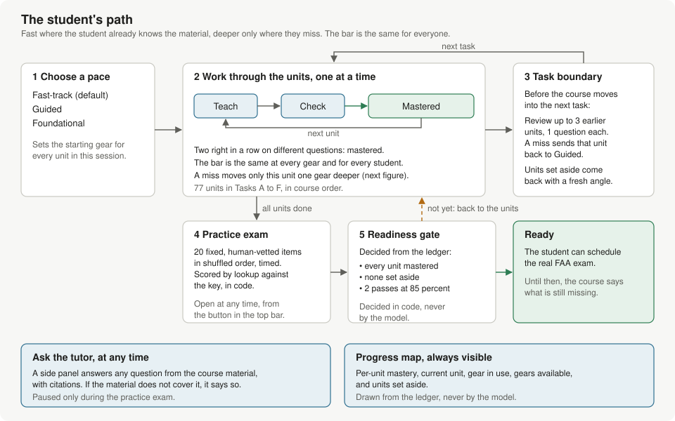
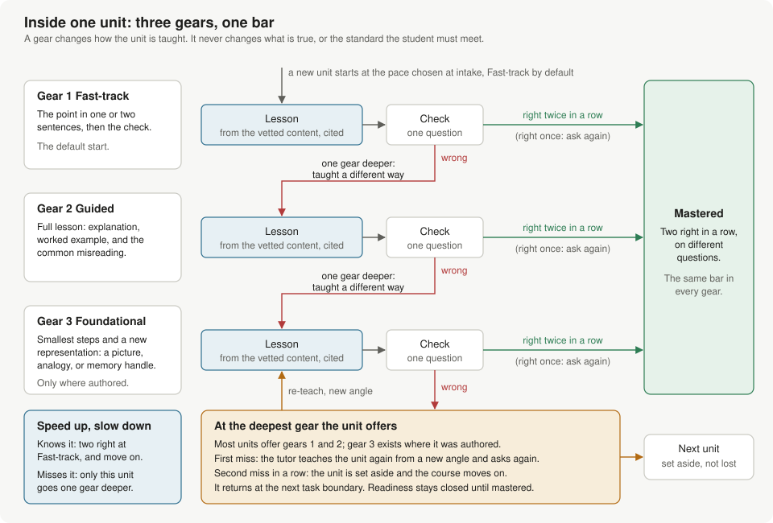
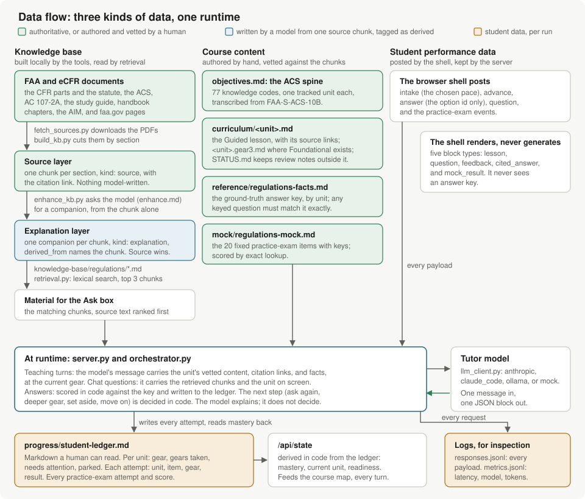
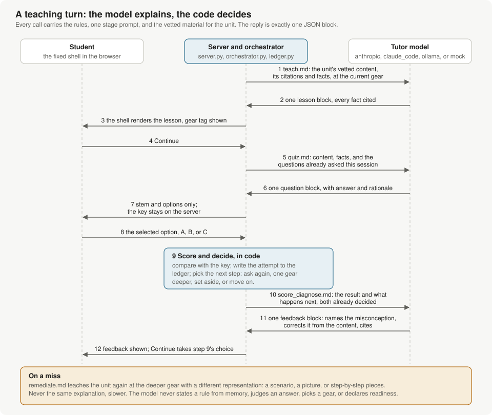
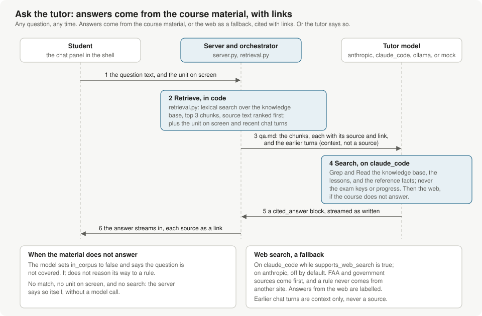

# FAA Part 107 course

An adaptive, LLM-tutored course for the FAA Part 107 remote pilot knowledge test.
Content is grounded in the CFR and FAA guidance; the model teaches over it rather
than being the authority on the rules.

Runs from this folder with no packages to install. Python 3.8 or newer is the only
prerequisite, plus a model backend (below).

## How the course works, in pictures

Five diagrams, drawn by hand from the code and prompts in this folder. They live
in `docs/diagrams/` as SVG files. Update them when the code they describe changes.

### The student's path



The student picks a pace at intake: Fast-track, Guided, or Foundational. That
choice sets the starting gear for every unit. The course then works through the
77 tracked units in order. Each unit is taught, then checked with a question.
Two correct answers in a row, on different questions, master the unit.

At each task boundary the course re-checks up to three mastered units from
earlier tasks, one question each. A miss sends that unit back for re-teaching
at the Guided gear. Units that were set aside come back here with a fresh angle.

The practice exam is open at any time. It has 20 fixed, human-vetted items and
is scored by lookup. The readiness gate is decided from the ledger, in code. It
needs every unit mastered, none set aside, and two exam passes at 85 percent or
better. The model never decides readiness.

### Faster or deeper: the gears inside one unit



A gear is a depth of teaching, not a different standard. Fast-track states the
point in one or two sentences and goes to the check. Guided gives the full lesson
with a worked example and the common misreading. Foundational breaks the point
into its smallest steps with a different representation, such as a picture or a
memory handle. Every unit with a Guided lesson offers all three. A unit's own
Fast-track or Foundational file comes first; without one, the tutor builds that
gear from the Guided lesson. The tutor's first Foundational lesson for a unit is
saved as that unit's file, marked as a draft for an instructor to review.

A student who knows the material answers two checks at Fast-track and moves on.
A miss moves only that unit one gear deeper. There the tutor teaches it a
different way, never the same explanation slower. At the deepest gear the unit
offers, the first miss brings a re-teach from a new angle. The second miss in a
row sets the unit aside. The course moves on and brings the unit back at the next
task boundary. Readiness stays closed until that unit is mastered.

### Data flow



Three kinds of data meet in the server. The knowledge base is built locally from
FAA and eCFR documents. Its source layer is cut mechanically from the documents.
A model writes its explanation layer from one chunk at a time. Those chunks are
tagged as derived, and the source text outranks them. Retrieval searches both
layers for the Ask box.

The course content is authored by hand and vetted against the source chunks. It
holds the ACS objectives, the per-unit lessons, the ground-truth facts, and the
fixed practice exam. Each tutor message carries the current unit's content,
citation links, and facts.

Student performance data lives in `progress/`, which is per run and not shipped.
The ledger is Markdown a human can read. Mastery, the current unit, and
readiness are derived from it in code. The same record feeds the course map
through `/api/state`.

### How the model teaches



Every model call carries the orchestrator rules, one stage prompt, and the vetted
material for the unit. The reply is one JSON block that the fixed shell renders.
The model writes the lesson, the question, and the feedback. The server checks
each question before it shows it: three distinct options, one key, and a
rationale. Where the question names a vetted fact, the keyed option must state
that fact. A question that fails is written once more. An instructor's own
questions on a unit come first and need no model call. The server keeps the
answer key and scores the student's choice by comparison. It records the attempt
and decides the next step in code. The feedback call then gives the model the
result and what happens next. The model explains a decision it did not make.

### How the model answers questions



The chat panel takes any question at any time. The server retrieves the best
matching chunks from the knowledge base. It adds the unit on screen and recent
chat turns, and sends them with the question. On the `claude_code` backend the
model can also search the course material itself: the knowledge base, the unit
lessons, and the reference facts. It cannot read the practice exam or the
student's progress. When the course material does not cover the question, it
searches the web, official FAA and government sources first. The model answers
from that material only, paraphrased and cited with links, and streams the
answer as it writes. If no material covers the question, it says so. On the
`anthropic` backend, web search is an optional fallback and is off by default.

## Run it

```bash
export ANTHROPIC_API_KEY=your-key   # for the default backend
./start.sh                          # or: python3 server.py
./start.sh --instructor             # adds the Instructor button, which edits the course material
```

Then open http://localhost:8107. If `./start.sh` reports a permission error, run
`chmod +x start.sh` once. Without `--instructor` (or `"instructor": true` in
`config.json`), the instructor workspace does not exist, so a student's copy
cannot change its course material. See "Improving the tutor" below.

**Speaking a question.** With the microphone button beside Send, a student can
speak a question. The browser's own speech recognition turns it into text.
Chrome sends the audio to Google, Edge to Microsoft, and Safari to Apple. Safari
needs Siri or Dictation turned on in macOS settings. Firefox has no speech
recognition, so it shows no button. Brave shows the button but has no speech
service. The words go into the question box. Nothing goes to the tutor until the
student presses Send. The speech service needs the internet, also with the
offline `ollama` backend.

## Choosing a backend

The backend is set by `provider` in `config.json`.

| Provider | Needs | Notes |
|---|---|---|
| `anthropic` (default) | `ANTHROPIC_API_KEY` in your environment, and connectivity | Best for distribution: each student supplies their own key. Billed per token. Can use cited web search for questions outside the course material once `supports_web_search` is switched on. |
| `claude_code` | [Claude Code](https://code.claude.com/docs/en/quickstart) installed and signed in to a Claude plan | Draws on your own plan instead of API billing, so it costs nothing extra while you build. Personal use only: plan allocation is per-user and cannot be shared with students. The chat tutor searches the course material, and the web while `supports_web_search` is true. |
| `ollama` | [Ollama](https://ollama.com) running locally with the model in `config.json` pulled | Fully offline and free. Free-form answers are limited to the course material. |
| `mock` | nothing | Canned blocks for testing the plumbing without a model. |

Your API key is read from the environment and is never stored in this folder.

Two notes on the `claude_code` backend. It runs `claude -p` with all tools disabled
for lessons, questions, and feedback, because the course has no business reading or
writing your files. The chat and the instructor's authoring assistant get read-only
tools instead. They run in the knowledge-base folder, may also read the lessons and
the reference facts, and nothing else; with `supports_web_search` they may also search
the web. No tutor call loads your Claude Code memory, settings, or MCP servers, so
your claude.ai connectors and plugins stay out of the tutor's reach and its context.
And setting
`ANTHROPIC_API_KEY` in your shell makes Claude Code bill to the API instead of your
plan, so keep that variable out of your shell profile if you use this backend.

Web search on the `anthropic` backend is off by default. The tool format is wired
but was not verified against the current API from the build environment. Turn it on
by setting `supports_web_search` to true, ask the tutor something outside the course
material, and confirm the answer carries a web link before leaving it on.

## Estimated AI costs

Estimated October 16, 2026, for one student working through all 77 units on the
`anthropic` backend or an equivalent Bedrock endpoint. The call counts follow the
course rules: one lesson per unit, two correct checks in a row to master it, one
re-teach per miss, 15 spaced reviews, and one debrief per practice exam. Prompt
sizes were measured from the authored Task A units. Output sizes come from the
recorded runs in `progress/metrics.jsonl`.

| Scenario | Model calls | Input tokens | Output tokens | Total tokens |
|---|---|---|---|---|
| Low: Fast-track, 10 percent miss rate, 5 chat questions | 530 | 1.4M | 0.34M | 1.7M |
| Mid: Guided, 25 percent miss rate, 15 chat questions | 760 | 2.1M | 0.68M | 2.8M |
| High: 40 percent miss rate, 30 chat questions | 1,180 | 3.5M | 1.37M | 4.8M |

Each teaching call sends about 1.8k tokens of system prompt and 0.7k to 0.9k tokens
of unit material. Each miss adds three calls. Output tokens are 55 to 66 percent of
the cost.

Cost per student on Amazon Bedrock, in US dollars. Global endpoints bill at the
first-party rate. Regional endpoints add 10 percent. The cached columns assume the
system prompt is cached, which needs a `cache_control` marker that `llm_client.py`
does not send yet.

| Scenario | Opus 5.5 global | Opus 5.5 regional | Opus 5.5 cached | Sonnet 5.5 global | Sonnet 5.5 regional | Sonnet 5.5 cached |
|---|---|---|---|---|---|---|
| Low | $12 | $14 | $9 | $6 | $7 | $5 |
| Mid | $22 | $24 | $18 | $11 | $12 | $9 |
| High | $41 | $45 | $34 | $21 | $23 | $17 |

Rates used, per million tokens: Opus 5.5 at $4 input, $20 output, $0.20 cache read,
$5 cache write. Sonnet 5.5 at $2 input, $10 output, $0.10 cache read, $2.50 cache
write. Opus 5 and Opus 4.8 cost about 25 percent more than Opus 5.5. Sonnet 4.6
costs 50 percent more than Sonnet 5.5.

Assumptions:

- Tasks B to F are not authored yet. Their units are assumed to match the Task A
  sizes, plus 10 to 25 percent in the mid and high scenarios.
- Both models think by default, and thinking bills as output. The output sizes were
  measured on Opus 5. The mid and high scenarios add 25 and 50 percent for thinking.
  Sending effort `low` holds output near the measured values.
- The chat on this backend is one call over three retrieved chunks and the unit on
  screen. It is cheaper than the recorded `claude_code` chat calls, which also
  searched the course and the web.
- The `context_tokens` recorded by the `claude_code` backend include Claude Code's
  own overhead. The API path sends 2.4k to 2.9k tokens per teaching call.
- The rates come from Anthropic's pricing page and its Bedrock endpoint rule.
  Confirm them on the AWS Bedrock pricing page before budgeting.

## Running the tests

```bash
python3 -m unittest discover -s tests -v
```

## Where this is up to

Built and tested: the interface shell, the server, the four backends, retrieval over
the knowledge base, deterministic scoring, the student ledger with the course map,
the adaptive tutor (teach, quiz, downshift on a miss, park after repeated misses at
the deepest gear, spaced review at task boundaries), the practice exam and the
readiness gate, and the build tools.

Authored but not vetted: teaching content and reference facts for all 77 units
(Task A and the gear-3 exemplars first; Tasks B to F written October 17, 2026
against the knowledge base), Foundational files for 7 units, and the 20-item
practice exam. See `curriculum/regulations/STATUS.md`.

Built on October 9, 2026: the knowledge base, both layers, from 39 sources (the
current eCFR text of the CFR parts, the statute, the ACS, AC 107-2A, the study
guide, the FAA sample questions, three handbook chapters, the AIM airspace and
UAS chapters, and the faa.gov guidance pages). `knowledge-base/BUILD.md` records
the build, its decisions, and two currency findings for the vetting step.

Built on October 16, 2026: all three speeds for every unit with a Guided lesson,
with the tutor's first Foundational lesson saved as a draft file, and the
instructor workspace (`./start.sh --instructor`). The plan and its as-built record
are in `docs/plans/instructor-interface.md`.

Built on October 17, 2026: the server checks each question the tutor writes, and
logs every question asked, so the tutor does not repeat one across sessions. The
workspace's Questions tab takes an instructor's guidance and own questions per
unit. The plan and its as-built record are in `docs/plans/check-questions.md`.

Not yet done, all local: vetting of everything against the source text, and a
full run with a real model. The content build is recorded in
`docs/plans/content-tasks-b-to-f.md`. Until a unit has content, the tutor
declines to teach it, by design; every unit now has a Guided lesson.

## Improving the tutor

This section is for instructors who know the subject, such as remote pilots and
flight instructors. You do not need to program to improve the course.

### What the tutor teaches from

The tutor knows only what is in the course files. It never teaches from memory.
Five kinds of file decide what it says:

| File | What it holds | Where |
|---|---|---|
| Lesson files | One Guided lesson per unit, and optional Fast-track and Foundational lessons | `curriculum/regulations/` |
| Reference facts | The exact facts that the tutor's questions are keyed to, each with its source | `reference/regulations-facts.md` |
| Questions files | Per unit: your guidance for the tutor who writes the questions, and your own questions with their keys | `questions/regulations/` (edit them in the Questions tab) |
| Knowledge base | The regulations and FAA guidance in chunks, for the "Ask the tutor" panel | `knowledge-base/regulations/` (built by a script; do not edit by hand) |
| Practice exam | 20 fixed questions with their keys | `mock/regulations-mock.md` |

The prompts in `prompts/` set how the tutor teaches, not what is true. Change them
only together with the course maintainer.

### Find what needs work

- **The course tree.** A unit that students reach at Foundational, set aside, or
  mark "needs attention" is not getting through. Hover a unit to see which lesson
  file each speed uses.
- **The student record,** `progress/student-ledger.md`. Its Attempts table lists
  each miss by unit and speed.
- **The chat questions,** in `progress/responses.jsonl` (the lines with
  `"type": "question"`). A question that students ask often shows a gap in the lesson.
- **The check questions asked,** in `progress/questions.jsonl`, each with its key
  and rationale. Look here for a weak question or a wrong key.
- **Tutor drafts.** A Foundational lesson that the tutor wrote waits for your
  review. The course tree calls it "a draft the tutor wrote", and `STATUS.md`
  shows `tutor draft v1` in its Gear 3 column.
- **Open questions** in the Notes column of `STATUS.md`.

### Where each fix goes

| Problem | Fix it in | How |
|---|---|---|
| A fact is wrong or out of date | The lesson file and the reference facts | Correct both against the CFR. Questions are keyed to the reference facts, so a fix in the lesson alone is not enough. |
| A lesson does not get through | The lesson file for that speed | Rewrite the explanation or the worked example, or add a diagram. |
| Students keep missing a unit | Its Foundational file | Review the tutor draft, or write the file. |
| A quiz question is weak or wrong | The lesson file and the reference facts | The tutor writes a new question each time, from the lesson and the facts. Make the fact exact, and name the common misreading in the lesson. |
| The questions miss a point that matters | The unit's questions file | In the Questions tab, write guidance such as "make sure the student understands X", or write the question yourself. |
| A practice-exam item is wrong | `mock/regulations-mock.md` | Correct the row. Keep one keyed answer, distinct wrong options, a rationale, and a link. |
| A chat answer is wrong | Tell the course maintainer | Chat answers come from the knowledge base, which the maintainer corrects or rebuilds. |

### Edit in the instructor workspace

1. Start the course with `./start.sh --instructor`. The top bar then shows an
   **Instructor** button. Without the flag, the button and all editing are gone,
   so a student's copy of the course cannot change its material.
2. Click **Instructor** on any screen. The workspace opens on the unit and the
   speed on screen. To edit another file, pick a unit from the list and a tab:
   **Fast-track**, **Guided**, or **Foundational**. The line next to the tabs
   says what that file is: a lesson file with its version, a tutor draft, or no
   file yet.
3. Edit the file in the left column. The middle column shows it as a student
   sees it, with its images and its sources.
4. Or ask the assistant in the right column. Write what you want as you would to
   a colleague, for example: "This looks good, but can we add a diagram that
   shows how the authorized altitude applies in the worked example?" The
   assistant replies with a note on what it changed and a proposal for the whole
   file. The proposal shows in the middle column. Under the note, **Changes**
   lists each line that it adds or removes. You can also speak the request with
   the microphone button beside Send (see "Speaking a question" above).
5. Read the proposal. **Apply** puts it into the editor, and **Discard** drops
   it. Ask again to adjust it, for example "make the labels larger". You can also
   edit by hand at any time. Nothing is saved until you click Save.
6. Click **Save**. Write a short note on what changed, then answer the question
   "Is this content vetted against the source text?" Choose **Yes, vetted** only
   after you have checked every fact, number, and diagram label in the file
   against the source text. The save raises the file's version, records your
   answer in `STATUS.md`, and stores each new diagram as an image file in
   `curriculum/regulations/images/`.
7. Click **Try it as a student** to see the tutor teach the unit at that speed
   from your file.

The **Questions** tab, next to the speeds, edits the unit's check questions:

- **Guidance** goes to the tutor each time it writes a question on the unit, for
  example "make sure the student understands that LAANC covers controlled
  airspace only". The tutor makes its questions cover each point you name.
- **Add a question** writes your own question: the stem, three options with the
  answer marked, why the answer is right, and a source with its link. The tutor
  uses the "why" in its feedback. The course asks your questions first, in
  order, before the tutor writes its own. Each student sees each one once.
- **Save** checks every question and saves nothing while one has a problem. The
  problems show above the questions. A new question gets its id on save, and a
  deleted question's id is never used again. Do not use the `|` character.

Your own progress counts the questions you see as asked, so the Questions tab
has no **Try it as a student** button.

For a speed with no file, the workspace offers **Start from the Guided lesson**
and **Ask the tutor for a first version**. A unit with no Guided lesson cannot be
taught at all, so write that file first.

The assistant follows the tutor's rules: facts come only from the course material,
and every source is cited. When the material does not support a request, it says
so in its note. Check its work all the same: a diagram can carry a wrong label as
easily as a sentence can carry a wrong fact. The assistant sends only its changes,
so a small change is quick. A request for a new diagram takes about 30 to 60
seconds, most of it the model thinking before it writes.

### The speeds and their files

| Speed | File | Without the file |
|---|---|---|
| Fast-track | `<unit>.gear1.md` | The tutor shortens the Guided lesson. |
| Guided | `<unit>.md` | The unit cannot be taught. |
| Foundational | `<unit>.gear3.md` | The tutor builds it from the Guided lesson and saves its first version as a tutor draft. |

A tutor draft is a real lesson file that later students get. While it is a draft,
the tutor also receives the Guided lesson and the reference facts, and those win
on any conflict. Your first save of the file removes the draft mark.

Write a Foundational file when students keep missing a unit, or when the tutor
draft does not teach it well. Write a Fast-track file only when the tutor's short
version misses the point.

### Write a lesson file by hand

A lesson file is plain text in Markdown:

```
---
source: 14 CFR 107.51 | https://www.ecfr.gov/current/title-14/section-107.51
source: AC 107-2A | https://www.faa.gov/documentLibrary/media/Advisory_Circular/AC_107-2A.pdf
version: 3
---
Objective: know the altitude limit and its exception for structures.

The plain-language explanation, then the worked example, then the common misreading.
```

- Write one `source:` line for each source the lesson uses, with its link. For a
  CFR section, use its eCFR section link.
- The course writes the `version:` line and the `draft:` line. Leave them as they are.
- **Guided:** the objective, a plain-language explanation, a worked example, and
  the common misreading.
- **Fast-track:** the point in one or two sentences.
- **Foundational:** the point in numbered steps, each taught a different way (a
  picture, an analogy, or step-by-step reasoning), a memory handle, then the
  worked example step by step.
- Keep every number exactly as the source states it.
- Do not put review notes or status words in the file. The tutor reads the file
  as it is, so a note there reaches a student. Notes go in `STATUS.md`.
- Put an image in `curriculum/regulations/images/`, and show it in the lesson as
  ``.

### Vet

To vet a file, check every fact in it against the source text in the knowledge
base. `docs/vetting-guide.html` is a guide and a per-unit checklist with links to
every file, source chunk, and open question; regenerate it with
`python3 tools/vetting_guide.py` after STATUS.md changes. The CFR outranks the Advisory Circular and the study guide. If two sources
disagree, follow the CFR and write the conflict in the Notes column of
`STATUS.md`; do not smooth it over in the lesson. Each save records your answer
in the unit's row, for example `v3 vetted` or `v3 edited`. A unit is vetted when
all its lesson files and its reference facts are vetted.

### Check and hand over your change

1. Run `python3 tools/check_integrity.py --allow-incomplete`. It finds a lesson
   without a source line, a fact without a link, and a broken exam item. It
   cannot check whether a fact is true; that part is yours.
2. Start the course and try the unit at the speed you changed.
3. Hand the change over. If you use git, commit the changed files and any new
   images, with a message that names the unit, the speed, and the change. If you
   do not use git, send the same files to the course maintainer.

## Building the content locally

These steps need the PDFs, network access, and a model, which is why they run on
your machine rather than in the build environment.

1. Run the tests, then set `provider` to `claude_code` in `config.json` so the
   build passes draw on your plan: `python3 -m unittest discover -s tests`.

2. Fetch the sources: `python3 tools/fetch_sources.py`. It reads the `fetch`
   block of each entry in `knowledge-base/sources.json` and writes the PDF the
   builder expects into `knowledge-base/pdfs/`: FAA PDFs are downloaded as
   published; the CFR parts are printed from the current eCFR text, and the
   AIM, faa.gov, and Federal Register pages from their main content, with
   headless Chrome. Needs network access and Chrome or Chromium. A source
   whose PDF is present is skipped; `--redo` refreshes it. The run is noted
   in `knowledge-base/pdfs/fetch-log.json`.

3. Build the source layer of the knowledge base. Needs `pdftotext` (poppler):
   `python3 tools/build_kb.py`. Check a few chunks in `knowledge-base/regulations/`
   against the PDF: section boundaries, page numbers, and the canonical links.
   If a source's headings are not cut where you expect, adjust its `heading`
   preset or give it a custom regex in the manifest and rebuild that source.

4. Add the explanation layer: `python3 tools/enhance_kb.py`. One companion chunk
   per source chunk, written by the model from the chunk and nothing beyond it,
   tagged `kind: explanation`. Spot-check a handful for added facts; the prompt
   forbids them, and a companion that adds one should be deleted and regenerated.
   `knowledge-base/EXPLANATION-LAYER.md` describes the layer and the vetting
   procedure, and `python3 tools/check_companions.py` lists the numbers in each
   companion that its source chunk does not contain.

5. Check the links and the structure:
   `python3 tools/check_links.py` and `python3 tools/check_integrity.py --allow-incomplete`.

6. Vet the authored content. For each unit in `STATUS.md`, read the content and
   its reference facts against the source chunks and mark the row vetted, or fix
   it. Do the same for every practice-exam item. The notes column holds the open
   questions the author flagged.

7. Run the course with a real model: `./start.sh`, choose Fast-track, work through
   Task A, miss a question on purpose to see the downshift, ask the tutor a
   free-form question, and take the practice exam. Watch the terminal for errors
   and `progress/student-ledger.md` for the state.

8. All 77 units have a Guided lesson and reference facts (Tasks B to F were
   written on October 17, 2026; see `docs/plans/content-tasks-b-to-f.md`). To add
   or revise content, follow the conventions at the bottom of `STATUS.md`, by hand
   or in the instructor workspace (see "Improving the tutor"), and run the
   integrity check without `--allow-incomplete`.

9. Package: `python3 tools/package.py` writes `dist/part107-course-<date>.zip`,
   refusing to package a course that fails the integrity check. Unzip it somewhere
   else and run it on each backend before handing it to anyone.

## How it fits together

```
ui/              the fixed shell: renders blocks, posts responses, draws the map and readiness;
                 instructor.js is the instructor workspace
server.py        serves the shell, routes responses, scores answers, calls the model,
                 saves tutor drafts and instructor edits
status.py        changes one unit's row of STATUS.md when a lesson file is saved
orchestrator.py  which unit, which gear, which stage comes next; task boundaries and review
mockexam.py      practice-exam attempts, lookup scoring, readiness
llm_client.py    provider adapters (anthropic, claude_code, ollama, mock)
retrieval.py     lexical search over the knowledge base, for free-form questions
items.py         table parsing, vetted items, deterministic lookup scoring
ledger.py        the student ledger: mastery, gears, parking, attempts, exam attempts
prompts/         the tutor: global rules, one prompt per stage, the block and response schemas;
                 author.md is the instructor's authoring assistant
curriculum/      objectives, per-unit teaching content, vetting status
reference/       the per-unit ground-truth facts the tutor keys answers to
mock/            the fixed practice exam
knowledge-base/  the source manifest and the two-layer corpus (built locally)
sources/         the authoritative references and their precedence
tools/           fetch_sources, build_kb, enhance_kb, check_companions, probe_retrieval, probe_chat, check_integrity, check_links, package
tests/           the test suite; fixtures live under tests/fixtures
docs/            the illustrated guide: the SVG diagrams shown at the top of this file
```

Design principles behind these choices are in `LLM_COURSEWARE_DESIGN_AND_PRINCIPLES.md`,
and the build plan is in `IMPLEMENTATION_PLAN.md`.
