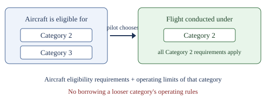

Objective: Multiple category sUAS.

**Why this rule exists.**

Start with the problem the regulation is solving. When a small unmanned aircraft fails over an empty field, it hits dirt. When it fails over a crowd, it hits a person. Subpart D of Part 107 is the FAA's answer to that one difference: it prescribes the eligibility and operating requirements for civil small unmanned aircraft to operate over human beings or over moving vehicles.

The FAA did not answer with a flat ban, and it did not answer with "use good judgment." Section 107.39 prohibits flying over a person who is not under safe cover, such as a protective structure or a stationary vehicle, unless the operation is conducted under one of the four categories in subpart D. Section 107.105 then says the same thing from the other side: a remote pilot in command may conduct operations over human beings only in accordance with those categories. So there is no general permission to fly over people. There are four specific doors, and your flight has to go through one of them.

Each door is built around how much harm the aircraft could do. Category 1 is limited to a maximum weight of 0.55 pounds, including everything on board or attached at takeoff and throughout the operation, and the aircraft must have no exposed rotating parts that would lacerate human skin on impact. Categories 2 and 3 require aircraft that meet performance-based safety requirements, which limit the risk and severity of injuries based on potential hazards. Category 4 relies on an airworthiness certificate issued under 14 CFR part 21, with operations over people permitted so long as the FAA-approved Flight Manual does not prohibit them. Different doors, same question behind each one: what happens to the person underneath.

That design is exactly why this unit exists. Because a category is a set of conditions an aircraft can meet rather than a brand stamped on the airframe, one aircraft can meet the conditions of more than one door at the same time. The regulation therefore has to fix which door you walked through on a given flight, and § 107.105 puts that choice, and the responsibility that follows it, on the remote pilot in command.

Let's build this one piece at a time.

**Piece 1: a category is a class the aircraft qualifies for, not a name stamped on it.**

The categories of operation over people, Categories 1 through 4, are eligibility classes for the aircraft. They are not labels tied to one aircraft forever. Think of them less like the color of the aircraft and more like the licenses in a person's wallet: a driver can hold a motorcycle endorsement and a car license at the same time, but on any given trip they are driving one vehicle under one set of rules.

**Piece 2: one aircraft can hold more than one of these at the same time.**

A single small unmanned aircraft system (sUAS) can be eligible for more than one category at once. For example, an aircraft could be light enough for Category 1 in one configuration and listed on a declaration of compliance for Category 2 in another configuration, or it could be eligible for both Category 2 and Category 3 on one declaration.

**Piece 3: the flight still happens under exactly one category, and you pick it.**

What matters to you as the remote pilot in command is the category the flight is conducted under. You choose that category for the operation.

**Piece 4: choosing a category means taking all of it.**

Once you pick the category, you must comply with all of that category's requirements: the aircraft eligibility requirements and the operating limits that come with it. Being eligible for a stricter category does not let you borrow the looser category's operating rules.

**Piece 5: walk the worked example one step at a time.**

1. The aircraft is listed for both Category 2 and Category 3.
2. The plan is sustained flight over a crowd at a fair. That crowd is an open-air assembly.
3. Check Category 3: it prohibits operations over open-air assemblies. So Category 3 cannot be the category for this flight.
4. Check Category 2: it allows sustained flight over open-air assemblies only if the aircraft meets the remote identification requirement.
5. So the pilot conducts the flight under Category 2 and lives with Category 2's limits, including that remote identification requirement.

**The misreading to guard against.**

People assume a Category 3 aircraft can do everything a Category 2 aircraft can. It cannot. Category 3 allows a heavier impact but imposes stricter operating limits. More permissive on the aircraft side does not mean more permissive on the operating side.

**One sentence to carry away:** the rules that apply are the rules of the category the operation is conducted under, and the remote pilot in command is the one who chooses it.
