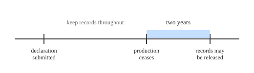

Objective: Record retention.

**Why this rule exists.** Flying over people rests on a claim. Before a small unmanned aircraft system (sUAS) can be operated over people in Category 2 or Category 3, someone has to show that the aircraft meets the requirements of § 107.120(a) or § 107.130(a). That showing is made on paper and up front: a declaration of compliance is submitted, and if the FAA determines compliance has been demonstrated, it notifies the applicant that the declaration is accepted.

A claim made on paper is only worth the evidence standing behind it, and that evidence has to outlive the day it was filed. That is the job of § 107.165. It takes the supporting information used to demonstrate compliance and requires that it be retained and made available to the Administrator on request. Pair it with § 107.7, which lets the Administrator ask a holder of an accepted declaration for that declaration and any other required record, inspect its facilities, technical data, and manufactured aircraft, and witness the tests needed to determine compliance. One rule keeps the evidence in existence; the other lets the FAA reach for it.

So every clock in this lesson is answering a single question: how long must the evidence behind the claim stay reachable? Keep that question in mind, and the two different time periods below stop looking arbitrary.

Let's take this one piece at a time. The word "records" in this part of the rule does not mean what most pilots expect, so we'll build it up slowly.

**Piece 1: this rule is not aimed at you as a pilot.**

Picture three different people standing around one drone:

- The **manufacturer** who built it and declared it eligible to fly over people.
- The **engineer or lab** who submitted the test method used to prove that eligibility.
- The **remote pilot** who picks it up and flies it.

Record retention in Part 107 lands on the first two. They are the ones who made the aircraft eligible for operations over people, so they are the ones who must be able to prove it later. The everyday remote pilot has no retention duty here.

**Piece 2: the manufacturer's clock.**

A person who submits a **declaration of compliance** (a formal statement that an aircraft meets the operations-over-people requirements) must keep the records that back it up. That means things like the test data and the means of compliance it relied on.

The clock is the part people get wrong, so hold this mental picture: the clock does not start when the declaration is filed, and it does not start when the drone is sold. It starts when the **assembly line stops**. The duty runs for **two years after that person ceases producing** the small unmanned aircraft system the declaration lists.

Walk the worked example through that picture. A small company designs a 3-pound aircraft, tests it to the Category 2 impact limit, and submits a declaration of compliance. Four years later it stops making the model. The two-year clock begins at that stopping point, so the test records must be kept for two more years after production ends, and handed over if the FAA asks.

**Piece 3: the means-of-compliance submitter's clock.**

This is a second, separate person with a second, separate clock. A person who submits a **means of compliance** (the method used to show the aircraft meets the requirement) must keep its supporting records for as long as the means of compliance is **accepted by the FAA, plus two years**. So the clock here is tied to acceptance, not to production.

One sentence to hold both apart:

- Declaration of compliance → two years after production ceases.
- Means of compliance → acceptance period, plus two years.

**Piece 4: keeping records is only half the duty.**

Records you keep but never show are no use to a regulator. These records must be made available to the FAA on request. That is the inspection duty in 107.7.

**Piece 5: what the remote pilot actually produces.**

Your obligation is a different thing entirely, and it is about presenting documents, not storing them for years. A remote pilot must be able to produce the certificate, the registration, and any waiver or authorization in effect, plus the remote pilot operating instructions for a Category 2 or 3 aircraft.

**The misreading to guard against.** Many pilots assume Part 107 makes them keep flight logs. It does not. Part 107 contains no flight-log requirement, although a waiver may impose one. If you keep a logbook, you keep it for your own reasons, not because this rule tells you to.
