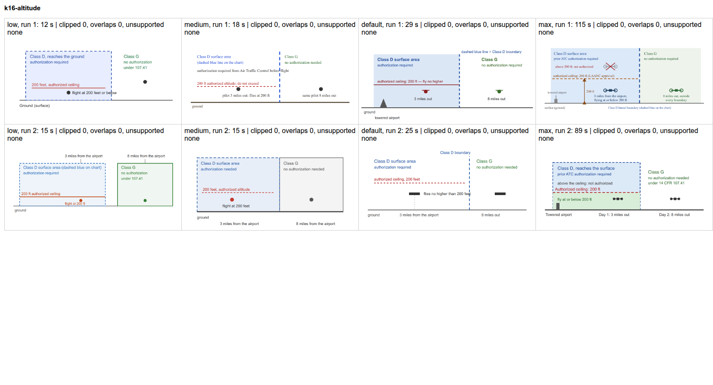
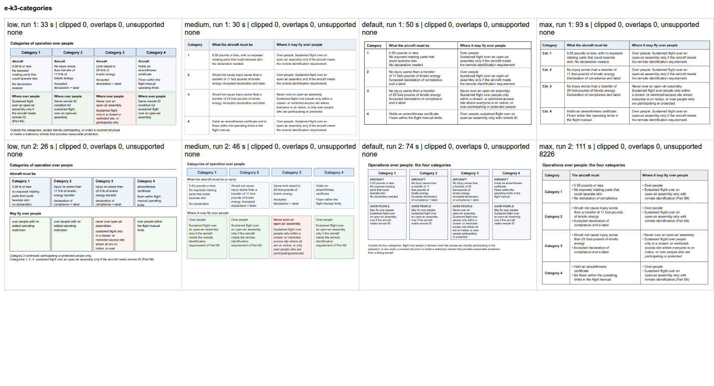
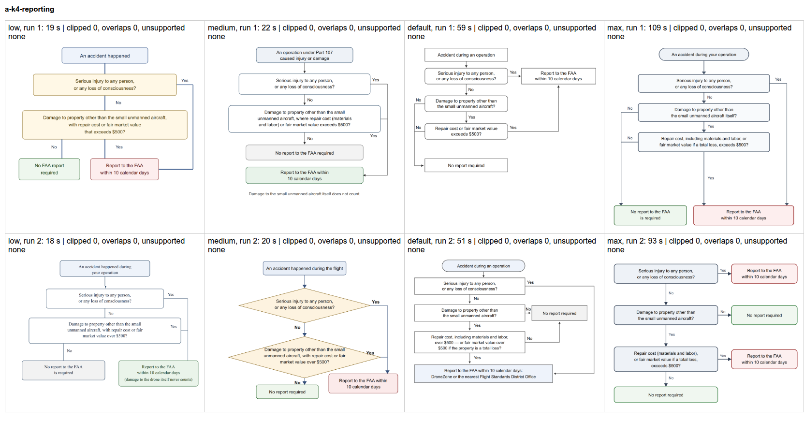

# Effort versus diagram quality for the authoring assistant

October 16, 2026. Question: does the Claude Code effort level change how correct and how useful the authoring assistant's diagrams are? Correctness and teaching quality come first; time comes second.

## Method

- Three diagram requests to the authoring stage (`prompts/author.md`), on committed lessons:
  1. **k16-altitude:** UA.I.B.K16, Foundational: "add a diagram that shows how the authorized altitude applies in the worked example".
  2. **e-k3-categories:** UA.I.E.K3, Guided: compare the four categories of operation over people, what each requires of the aircraft and where each may fly over people.
  3. **a-k4-reporting:** UA.I.A.K4, Guided: a decision diagram for whether an accident must be reported, and by when.
- Four effort levels (`low`, `medium`, the default with no `--effort` flag, `max`), two runs each: 24 calls on Claude Opus 5 through `claude -p`. Course search was off, so the effort level was the only change.
- Automatic checks (`run.py`, `check.py`): the reply applies to the file; no lesson line is removed; the SVG is safe; every number in a label is in the material the model received; no label is clipped at the edge or overlaps another label, measured in Chrome.
- My review of every diagram against the lesson: facts right, conditions complete, readable, and showing the point that was asked for.

Rerun: `python3 docs/investigations/effort-vs-diagrams/run.py`, then `check.py`. Each run is one call on the plan.

## Results

### Automatic checks

All 24 replies used changes (`edits`), all applied to the file, none removed a lesson line, and none needed the whole-file retry. No label was clipped and no two labels overlapped. Every number in every label was in the material. (The one flag, `8226` in e-k3-categories max run 2, is the bullet character `&#8226;`, a false alarm in the check.)

| Effort | Time per call | Output tokens | Of which thinking |
|---|---|---|---|
| low | 12 to 33 s | 1,000 to 3,600 | 24 to 119 |
| medium | 15 to 46 s | 1,300 to 4,800 | 165 to 998 |
| default | 25 to 74 s | 1,900 to 7,300 | 770 to 3,200 |
| max | 89 to 115 s | 7,400 to 11,000 | 5,100 to 8,100 |

The default thinks more than medium and much less than max, so it is most likely `high`. The max runs came close to the `claude_code` timeout of 120 s, which an instructor request already hit once in a real session (UA.I.A.K5, October 16, 14:32).

### Review

| Run | Facts | Complete | Layout | Notes |
|---|---|---|---|---|
| k16-altitude low 1 | right | yes | **label crosses the boundary line** | simple and clear otherwise |
| k16-altitude low 2 | right | yes | clean | |
| k16-altitude medium 1 | right | yes | **label crosses the boundary line; no font set (serif)** | |
| k16-altitude medium 2 | right | yes | clean | |
| k16-altitude default 1 | right | yes | clean | airport, ceiling, both distances |
| k16-altitude default 2 | right | yes | **label crosses the boundary line** | |
| k16-altitude max 1 | right | yes, most detail | no font set (serif), small text | arrow to the ceiling, X above it |
| k16-altitude max 2 | right | yes | clean | the best for teaching: authorized zone, "above the ceiling: not authorized", day 1 and day 2 |
| e-k3-categories low 1 | **incomplete** | **no** | clean | Category 3: "closed or restricted site, or participants only" drops "where everyone is on notice" and "or protected" |
| e-k3-categories low 2 | **contradicts itself** | **no** | text cut, continued in a footnote | Categories 1 and 2: "no added operating restriction", against its own Remote ID footnote |
| e-k3-categories medium 1 | right | yes | clean | |
| e-k3-categories medium 2 | right | yes | clean | |
| e-k3-categories default 1 | right | yes | clean | |
| e-k3-categories default 2 | right | yes | clean | adds the general exceptions |
| e-k3-categories max 1 | right | yes | clean | "declaration" without "accepted" |
| e-k3-categories max 2 | right | yes | clean | "25 foot-pounds" without "a transfer of" |
| a-k4-reporting low 1 | right | total loss not named | clean | |
| a-k4-reporting low 2 | right | total loss not named | no font set (serif); report box green, no-report box grey | colors reversed against the other runs |
| a-k4-reporting medium 1 | right | yes | clean | notes that damage to the drone does not count |
| a-k4-reporting medium 2 | right | total loss not named | clean | |
| a-k4-reporting default 1 | right | yes | clean | |
| a-k4-reporting default 2 | right | yes, most complete | clean | materials and labor, total loss, DroneZone or FSDO |
| a-k4-reporting max 1 | right | yes | clean | |
| a-k4-reporting max 2 | right | yes | clean | |

Every decision diagram follows the right logic, and every number is right.

### Comparison sheets

Effort levels across (low, medium, default, max), runs down.

## Findings

1. **Low effort is not safe for correctness.** On the hardest request, both low runs taught a wrong or incomplete rule about operations over people. No run at medium or above had a factual error.
2. **Medium, default, and max were equally correct** in this sample: 0 factual errors in 6 diagrams each. Max did not add correctness. It gave the richest altitude diagram, but also one diagram with small serif text, and it took 3 to 4 times as long as the default.
3. **The remaining defects are layout, at every level:** labels across a line (4 of 24), no font set so the browser draws serif text (4 of 24), and a reversed color code (1). The automatic check does not see a label crossing a line; it sees only labels that overlap other labels.
4. **Time:** the default takes 25 to 74 s; max 89 to 115 s, near the 120 s timeout.

The sample is small: two runs per level per request. The finding on low effort is strong (2 of 2 runs failed on the same request). The equality of medium, default, and max is weaker evidence.

## Recommendation

1. **Keep the default effort** for the authoring assistant. Do not use low. Max costs 3 to 4 times the time for no correctness gain seen here.
2. **Give the authoring stage a longer timeout,** for example 300 s, so a slow request does not fail at 120 s after the instructor has waited.
3. **Target the layout defects directly:**
   - add to the diagram rules in `prompts/author.md`: set `font-family` on the drawing, keep every label clear of lines and shapes, and make a box larger rather than cut a rule short
   - extend the save check to warn when a label crosses a line, as it does for a missing source line
4. Optional, for later: a second model pass that checks each diagram's statements against the facts before the instructor sees it. No error at medium or above needed it here.
